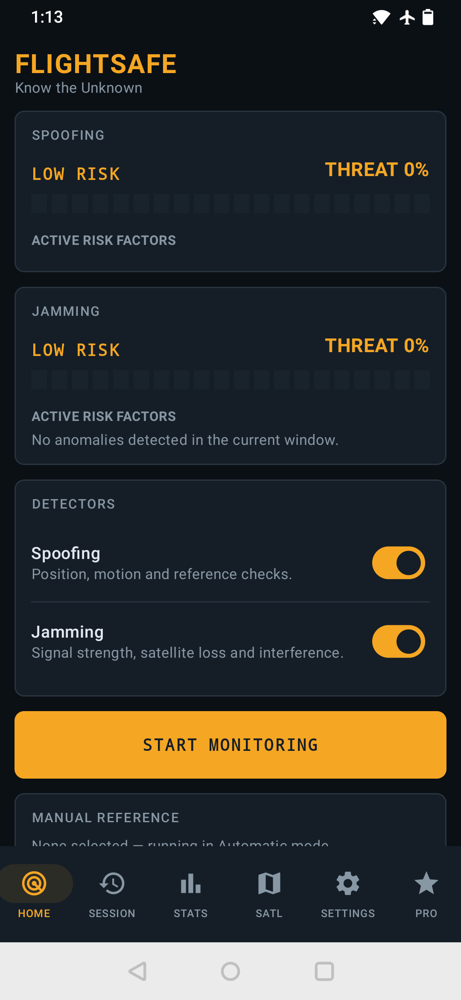
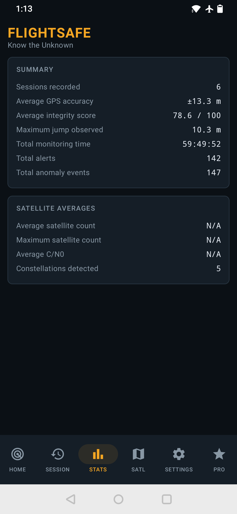
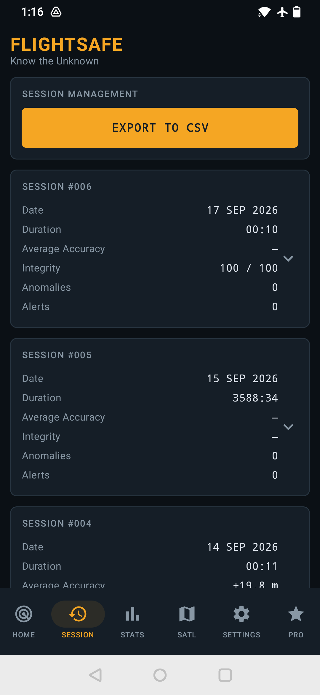
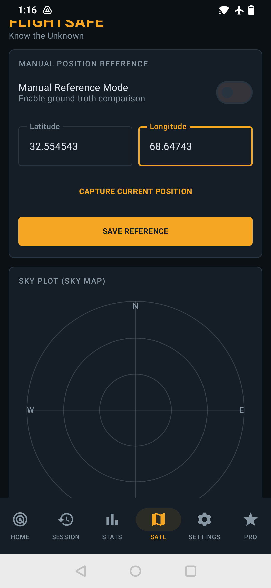

# 🛰️ FlightSafe – GNSS/GPS Spoofing & Jamming Detector

**Know the Unknown. Verify Your GPS. Fly with Confidence.**

FlightSafe is an Android application designed to monitor GNSS/GPS signal conditions, assess positioning reliability, and identify potential navigation anomalies that could affect drone operations.

Whether you're a drone enthusiast, UAV operator, or technology enthusiast, FlightSafe helps you better understand the GPS environment around you.

## 🚀 Key Features

- **GPS Signal Monitoring:** Monitor satellite visibility and GNSS signal conditions.
- **Spoofing Detection:** Identify potential GPS spoofing indicators and positioning anomalies.
- **Jamming Detection:** Monitor signal degradation and conditions that may indicate GPS interference.
- **GNSS Integrity Assessment:** Evaluate positioning quality and reliability.
- **Satellite Information:** Access useful satellite and positioning telemetry.
- **Flight Readiness Insights:** Understand potential GNSS-related risks before operating your drone.

## 🎯 Who Is FlightSafe For?

- Drone pilots and UAV operators
- FPV enthusiasts
- Drone developers and researchers
- GNSS and GPS technology enthusiasts
- Anyone interested in satellite navigation integrity

## 📲 Download FlightSafe

**Get FlightSafe on Google Play:**

[**Download on Google Play →**](https://play.google.com/store/apps/details?id=com.orbitforgestudios.flightsafe)

Package Name: `com.orbitforgestudios.flightsafe`

## 🛡️ Privacy First

FlightSafe is designed with privacy in mind. Refer to our privacy policy for details about permissions, location access, and data handling.

[Read our Privacy Policy](https://orbitforgestudios.github.io/flightsafe-privacy-policy)

## 📱 FlightSafe App Screenshots

### GNSS Monitoring Dashboard

### Satellite Monitoring

### GNSS Integrity Assessment

### Flight Readiness

## 🏢 Developer

**OrbitForge Studios**

Independent Android app and game development studio.

## ⭐ Support the Project

If you find FlightSafe useful:

- Download and try the application.
- Share it with drone pilots and UAV communities.
- Star this repository to support its visibility.
- Share your genuine feedback and suggestions.

Your support helps independent developers build better tools for the drone community.

---

**FlightSafe – Know the Unknown.**

*Disclaimer: FlightSafe provides GNSS monitoring and potential anomaly indicators. It does not guarantee detection of every spoofing or jamming attack and should not replace certified aviation safety equipment or established pre-flight procedures.*
